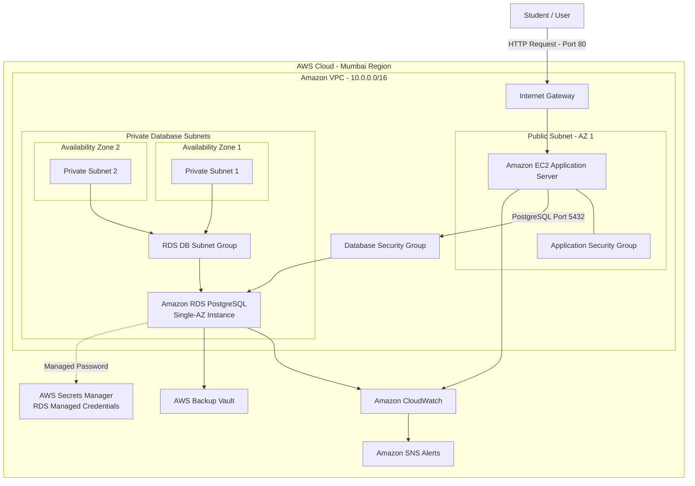


# Student Task Management - Cloud Architecture

## Architecture Diagram

## Architecture Components

| Component | Purpose |
|---|---|
| Amazon VPC | Provides an isolated network |
| Public Subnet | Hosts the EC2 application server |
| Private Subnets | Provide database subnet placement across two AZs |
| Internet Gateway | Provides internet connectivity to the public subnet |
| Amazon EC2 | Runs the application server |
| Amazon RDS PostgreSQL | Stores student task data |
| Application Security Group | Controls application server traffic |
| Database Security Group | Allows PostgreSQL access from the application security group |
| AWS Secrets Manager | Stores RDS-managed database credentials |
| Amazon CloudWatch | Monitors EC2 and RDS metrics |
| Amazon SNS | Sends monitoring notifications |
| AWS Backup | Manages scheduled database backups |

## Database Availability

The RDS DB subnet group spans two Availability Zones. However, the current RDS configuration uses `multi_az = false`, so the database does not have a Multi-AZ standby instance.

## Backup Configuration

- AWS Backup daily schedule.
- Seven-day AWS Backup retention.
- Seven-day RDS automated backup retention.
- Encrypted RDS storage.