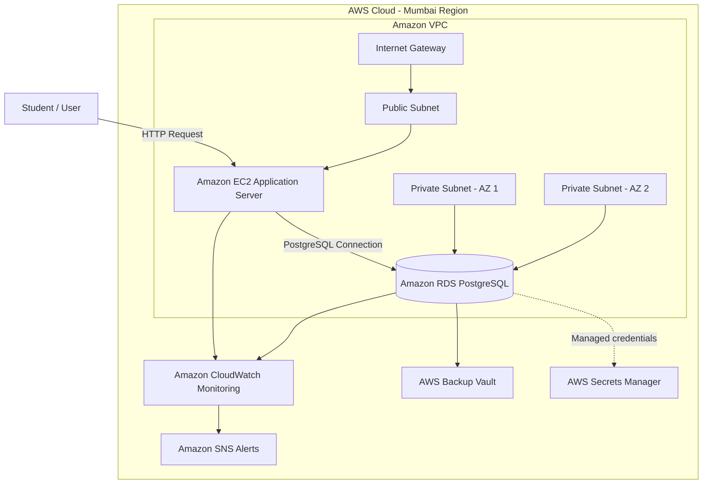

# Student Task Management – Cloud Architecture

## Architecture Diagram

## Architecture Components

| Component | Purpose |
|---|---|
| Amazon VPC | Provides an isolated network |
| Public Subnet | Hosts the application server |
| Private Subnets | Host the database network |
| Internet Gateway | Allows internet access to the public subnet |
| Amazon EC2 | Runs the application server |
| Amazon RDS | Stores student task data |
| AWS Secrets Manager | Manages database credentials |
| Amazon CloudWatch | Monitors application and database metrics |
| Amazon SNS | Sends monitoring notifications |
| AWS Backup | Stores database backups |
